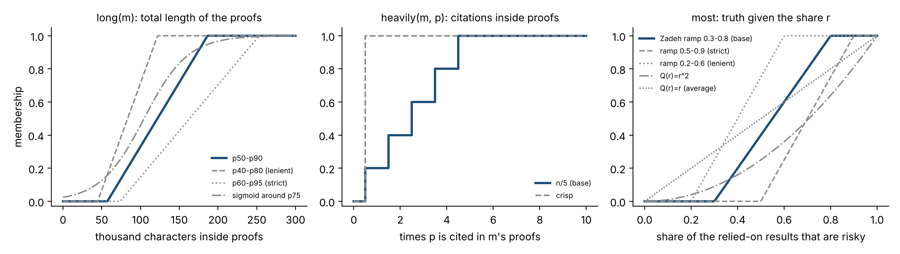
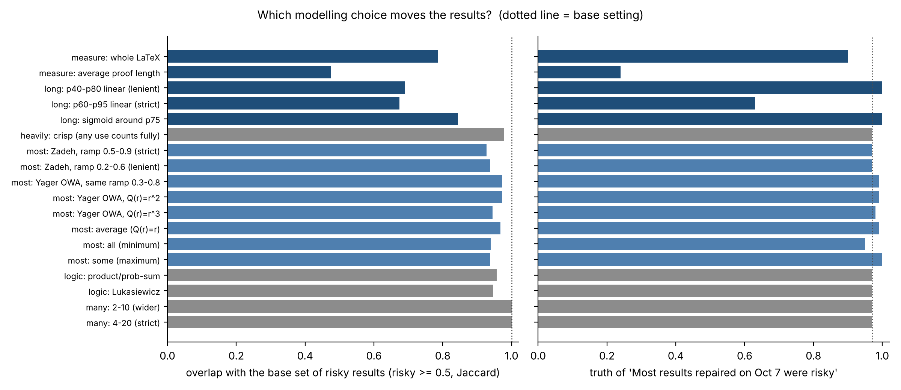
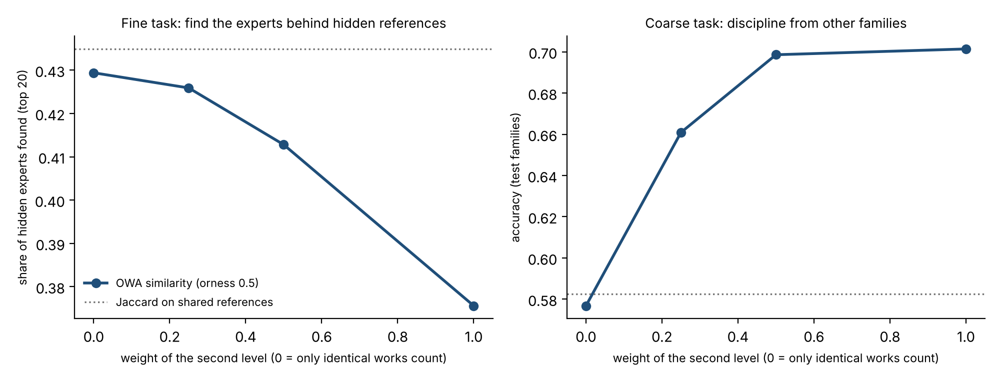

# Fuzzy reasoning over a knowledge graph of AI-generated mathematics

A knowledge graph of OpenAI's public release of AI-generated mathematics ([openai/math](https://github.com/openai/math)), and three questions answered on it with fuzzy methods:

1. **Trust.** Which results are risky, and which unchecked results do many others rest on?
2. **Relatedness.** Does OWA concept similarity ([Wang, Yager and Reformat, IPMU 2024](#reference)) group related results?
3. **Reviewers.** Who could review a given manuscript?

The aim is an understandable picture of a complex structure, not a model that beats others. Every score can be traced to a rule in words, and every modelling choice is varied to show how much it moves the results.

## The graph

| Element | Count | Notes |
| --- | --- | --- |
| Manuscript | 761 | 730 current, 28 older editions, 3 withdrawn; 186 checked by Lean |
| Family / Discipline | 375 / 17 | OpenAI's own grouping, used as ground truth |
| Paper (cited human work) | 11,321 | merged by DOI, then arXiv id, then title and year |
| Author | 8,492 | authors of the cited works |
| CITES | 18,999 | weighted by how often the work is cited in the text |
| DEPENDS_ON | 452 | one AI manuscript uses a result of another inside a proof |
| MENTIONS | 233 | the other manuscript is cited only in the introduction |

Separating *uses* from *mentions* matters. Counted together, 121 pairs of manuscripts cite each other. After the split, 21 pairs truly use each other's results.

## Main findings

**Fuzzy rules in words.** Three plain-language rules give every result a risk score with its reason:

- **R1.** A result is *risky* if it has no Lean proof, and either it is *long*, or *most* of the results it *relies on heavily* are risky.
- **R2.** A result is a *critical foundation* if *many* results rest on it and it is risky.
- **R3.** Two results *support each other suspiciously* if each relies heavily on the other and neither has a Lean proof.

The words are fuzzy sets with breakpoints taken from the data. Each choice (what "long" is measured on, its breakpoints, eight versions of "most", three pairs of and/or operators, two meanings of "many") was varied one at a time, 19 settings in all.





- Quantifiers and T-norms barely move the results. The meaning of "long" and "many" moves them most: the model is sensitive where a human judgement enters.
- Three unchecked results are critical foundations in 18 of 19 settings: *Log abundance in characteristic zero*, *Minimal models and Mori fibre spaces for generalized log canonical Q-pairs* and *The spacetime Penrose inequality and enclosing area*.
- The most suspicious circular pair (R3), two Kähler-geometry manuscripts, was already circular on October 5. OpenAI repaired both on October 7.
- "Most results repaired on October 7 were risky" has truth 0.97 on the October 6 graph. "Few of the other results were risky" has truth only 0.28, so the rule is a filter for review, not a detector of errors.
- The repaired manuscripts had many proofs, not unusually long single proofs.

**OWA concept similarity: one weight, opposite effects.** The second level of the similarity compares different cited works through their authors and arXiv area. It helps a coarse task and hurts a fine one, so its weight should follow the task.



| Method | Discipline from other families (accuracy) | Hidden experts found (top 20) |
| --- | --- | --- |
| Jaccard on shared works | 0.58 | 43.5% |
| OWA similarity, one level | 0.58 | 42.9% |
| OWA similarity, two levels | 0.70 | 37.6% |
| Flat bag: works + their authors + areas | 0.72 | |

The two-level similarity gains 12 points over Jaccard on the coarse task (95% interval 7 to 17). It does not beat a flat bag of the same information, so the gain comes from the second level's information, not from the OWA operator itself.

**Reviewers.** Hiding half of each bibliography (2,093 cases), the authors cited by the most similar manuscripts recover 43% of the hidden experts. For *The Exponential Time Hypothesis is False*, the three reviewers OpenAI named rank 1st, 2nd and 10th.

**Trust propagation with OWA.** On the October 6 graph, trust passed along dependencies ranks the 14 manuscripts repaired on October 7 above chance (AUC 0.72), but no better than simple counts. The OWA setting barely matters, because 64% of manuscripts use no other AI result. (In `auc_vs_orness.png` the "random" line is one random draw; its expected value is 0.5.)

## Run it

Requires Python 3.10+ and a local copy of [openai/math](https://github.com/openai/math). The Lean folder is not needed:

```bash
git clone --filter=blob:none --no-checkout --depth 1 https://github.com/openai/math openai-math
cd openai-math
git sparse-checkout set --no-cone "/*" "!/lean/*" "/lean/formalization.yaml"
git checkout main
cd ..
```

On Windows, run `git config --global core.longpaths true` first.

```bash
pip install -r requirements.txt
python build_graph.py openai-math out      # graph as CSV files       (~10 s)
python trust_owa.py out results            # trust and review list    (~1 min)
python similarity.py out results           # OWA concept similarity   (~30 s)
python reviewer_test.py out results        # reviewer test            (~3 min)
python fuzzy_rules.py out results          # fuzzy rules in words     (~3 s)
python fuzzy_figures.py out results
```

To explore the graph in Neo4j (Desktop, Community or Aura):

```bash
python load_neo4j.py out                   # asks for the password; --wipe to reload
python add_results_to_neo4j.py results     # adds trust scores and SIMILAR_TO links
```

Then paste the blocks from `queries.cypher` and `queries_analysis.cypher` into Neo4j Browser. Settings: `NEO4J_URI` (default `bolt://localhost:7687`), `NEO4J_USER`, `NEO4J_PASSWORD`, `NEO4J_DATABASE`.

## Files

| File | What it does |
| --- | --- |
| `build_graph.py` | Reads the repository and writes nodes and edges as CSV (standard library only) |
| `load_neo4j.py`, `add_results_to_neo4j.py` | Load the graph and the results into Neo4j |
| `fuzzy_rules.py`, `fuzzy_figures.py` | Rules R1 to R3, fuzzy sets, quantifiers, sensitivity, linguistic summaries |
| `similarity.py` | OWA concept similarity, two tasks, baselines |
| `reviewer_test.py` | Reviewer suggestion test and the second-level trade-off |
| `trust_owa.py` | Trust propagation and the review list |
| `queries.cypher`, `queries_analysis.cypher` | Starter questions for Neo4j |
| `results/` | Figures and result tables from the run above |

`results/fuzzy/scores.csv` gives each manuscript its scores and the reason in words.

## Limits

- Only 14 repairs, in about 5 clusters, so no difference between trust scores is significant.
- "Author of a hidden reference" stands in for "good reviewer"; only one manuscript has named reviewers.
- OWA weights come from quantifiers Q(r), not the InHyp family of the IPMU paper.
- Lean status is taken from `lean/formalization.yaml` as of the download; Lean proofs may assume the results they rely on.

## Reference

Y. Wang, R. R. Yager and M. Z. Reformat, "Similarity of Concepts in Weighted Knowledge Graphs", in *Information Processing and Management of Uncertainty in Knowledge-Based Systems (IPMU 2024)*, Springer. [doi:10.1007/978-3-031-74003-9_15](https://doi.org/10.1007/978-3-031-74003-9_15)

## Data and license

The graph is derived from [openai/math](https://github.com/openai/math), released under the Apache License 2.0. The code here is released under the MIT License.
